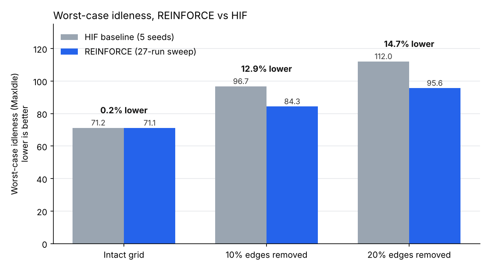
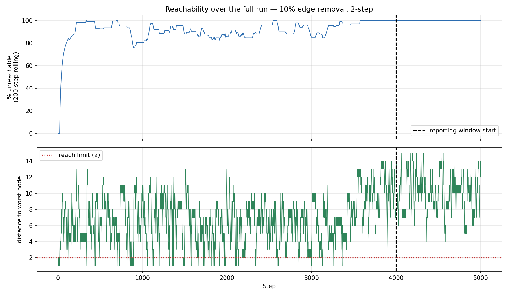

# Multi-Robot Persistent Patrolling with Rollout Planning and Reinforcement Learning

Research code from a summer internship at **IIT Bombay** (June to August 2026), carried out under the supervision of **Prof. Arpita Sinha**.

Two robots patrol a 10x10 grid graph indefinitely. Every node accumulates *idleness* (steps since it was last visited), and the goal is to keep the **worst-case idleness** low, so that no part of the graph is neglected for long. The project studies how three families of policies behave on intact grids and on damaged grids where 10% or 20% of the edges have been removed:

1. **Highest-Idleness-First (HIF)**, a coordinated greedy heuristic used as the baseline.
2. **Rollout planning** (Bertsekas-style lookahead of 2, 3 and 5 steps), guided by a learned value network.
3. **REINFORCE**, a policy-gradient agent trained from scratch to minimise worst-case idleness directly.

## Key results

The REINFORCE policy was trained in a 27-run sweep (3 graph topologies x 3 discount factors x 3 training seeds) and each trained policy was evaluated from 5 fixed starting positions. The metric is mean MaxIdle over the last 1,000 steps of a 5,000-step episode; lower is better. HIF is averaged over 5 tie-breaking seeds.

| Graph | HIF MaxIdle | REINFORCE MaxIdle | Improvement | REINFORCE better in |
|---|---|---|---|---|
| Intact grid (0% removed) | 71.2 | 71.1 | 0.2% | 21 / 45 cases |
| 10% edges removed | 96.7 | 84.3 | **12.9%** | **45 / 45 cases** |
| 20% edges removed | 112.0 | 95.6 | **14.7%** | **45 / 45 cases** |



Reproduce this table with `python scripts/compare_to_baseline.py`.

What the results show:

- On damaged graphs, the learned policy beat HIF in every one of the 90 evaluation cases, across all discount factors and seeds.
- On the intact grid, REINFORCE and HIF are effectively tied. HIF is already a strong policy when the graph has no dead ends.
- The size of the improvement depends on how many seeds the baseline is averaged over. Against a single HIF run the gains appear larger (17.7% and 16.6%); the multi-seed figures above are the honest ones.
- The reward penalises the worst node only, so the policy deliberately trades average idleness for worst-case idleness. Its average idleness is roughly 10% higher than HIF's on all three graphs (for example, 34.2 vs 30.9 on the 10% damaged grid).

### Findings from the earlier stages

- **Rollout planning fails when the worst node is out of reach.** When the most neglected node lies beyond the lookahead horizon, every candidate move looks equally good and the planner cannot steer towards it. The fraction of decisions affected falls as lookahead depth increases, and edge removal makes it worse by creating dead ends.
- **Offline accuracy does not predict planning quality.** Value networks trained with different seeds differed by at most 0.018 in R², yet the rollout planners built on them produced MaxIdle values ranging from 164 to 2,870.
- **The supervised target was largely determined by the current state.** On a redesigned 31-feature representation, ridge regression matched the neural network, which pointed towards learning the policy directly rather than predicting values.
- **Long-run HIF behaviour is governed by tie-breaking randomness**, not by the starting positions of the robots.



*Rollout planner on a 10% damaged grid with 2-step lookahead. The worst node quickly moves beyond the planner's reach (bottom panel), after which almost every decision is made without it in view (top panel).*

## Problem setup

| Item | Value |
|---|---|
| Graph | 10x10 grid, 100 nodes, 4-neighbour connectivity |
| Damage | 0%, 10% or 20% of edges removed at random (seed 123), keeping the graph connected |
| Robots | 2, each moving one edge per step (the REINFORCE policy also disallows immediate U-turns unless no other move exists) |
| Coordination | Robot 2 avoids the node Robot 1 has chosen |
| Idleness | +1 per step for every node, reset to 0 on a visit |
| Objective | Minimise MaxIdle (worst-case idleness) |

## Methods

**HIF baseline** (`src/hif_baseline.py`, `src/patrolling_sim.py`). Each robot moves to the neighbouring node with the highest idleness, with ties broken at random. Robot 1 chooses first and Robot 2 avoids its destination.

**Value prediction** (`notebooks/02_value_prediction`). An MLP was trained on 10,000 HIF simulations to predict future worst-case and average idleness from a snapshot of the system state. This stage also exposed a leakage issue: a snapshot taken inside the label window made one feature almost perfectly predictive, which was identified and documented as a diagnostic finding.

**Rollout planning** (`notebooks/03_rollout_planning`). At each step, candidate joint moves are expanded 2, 3 or 5 steps ahead and scored with the value network, following the rollout approach of Bertsekas. Evaluated on all 9 combinations of depth and edge removal.

**Feature redesign** (`notebooks/04_feature_redesign`). The 300-value raw input was replaced by 31 local, distance-aware features. A deterministic distance-based tie-breaker was also tested in place of the network.

**REINFORCE** (`src/rl_core.py`, `notebooks/05_reinforce`).
- Policy: a small MLP (2 inputs, 8 hidden units, LeakyReLU) scores each candidate move, and a softmax over the scores gives the action distribution. Inputs are the candidate node's idleness (scaled by 50) and its graph distance to the current worst node (scaled by 10). Both robots share the network.
- Reward: r(t) = -MaxIdle(t).
- Training: discounted returns with gamma in {0.95, 0.97, 0.99}, standardised per episode, entropy bonus 0.02, Adam with learning rate 3e-3, 1,500 episodes of 600 steps, 4 episodes per gradient update, random starting positions.
- Collisions: if both robots pick the same node, a joint search over both robots' candidates selects the best non-colliding pair.
- Evaluation: greedy policy, 5,000 steps, 5 fixed starting positions, with a collapse check that flags runs where a node is permanently abandoned.

## Repository structure

```
multi-robot-patrolling-rl/
├── src/
│   ├── hif_baseline.py          # standalone HIF simulation with plots and heatmaps
│   ├── patrolling_sim.py        # HIF simulator used to generate training data
│   └── rl_core.py               # graphs, REINFORCE policy, training and evaluation
├── scripts/
│   ├── compare_to_baseline.py   # reproduces the results table above
│   └── reverdict_rollouts.py    # collapse detection over saved rollout runs
├── notebooks/
│   ├── 01_hif_baseline/         # uncoordinated vs coordinated HIF
│   ├── 02_value_prediction/     # MLP value prediction, dataset generation
│   ├── 03_rollout_planning/     # 2/3/5-step rollout on 0/10/20% removal (9 notebooks)
│   ├── 04_feature_redesign/     # 31-feature representation, distance tie-breaker
│   └── 05_reinforce/            # full 27-run REINFORCE sweep
├── results/
│   ├── rl_sweep/                # sweep_results.json (per-run, per-start results)
│   └── rollout/                 # five-start evaluations and tie logs
├── figures/
│   ├── reinforce/               # results chart
│   └── rollout/                 # reachability diagnostics and trajectory plots
├── models/
│   ├── reinforce/               # 27 trained policy networks
│   └── rollout_value_net/       # value networks used by the rollout planner
├── data/                        # 10,000-run HIF datasets (0/10/20% removal)
├── requirements.txt
└── LICENSE
```

## Getting started

```bash
git clone https://github.com/Matrixco123/multi-robot-patrolling-rl.git
cd multi-robot-patrolling-rl
python -m venv .venv
source .venv/bin/activate          # Windows: .venv\Scripts\activate
pip install -r requirements.txt
```

Reproduce the headline results (a few minutes on a laptop CPU):

```bash
python scripts/compare_to_baseline.py --baseline-seeds 5
```

Run the HIF baseline on its own:

```bash
python src/hif_baseline.py
```

Train a REINFORCE policy on the 10% damaged grid (this takes a while on a CPU):

```python
import sys; sys.path.insert(0, "src")
from rl_core import build_graph_with_removal, all_pairs_bfs, train, evaluate_policy

nb = build_graph_with_removal(0.10, seed=123)
D = all_pairs_bfs(nb)
net = train(nb, D, n_episodes=1500, steps_per_ep=600, gamma=0.97, seed=0,
            episodes_per_update=4)
for row in evaluate_policy(net, nb, D):
    print(row)
```

Load a trained policy instead of training one:

```python
import sys; sys.path.insert(0, "src")
import torch
from rl_core import UtilityNet
net = UtilityNet(hidden=8)
net.load_state_dict(torch.load("models/reinforce/rl_net_10pct_g97_seed0.pt"))
```

## Notes on reproducibility

- Experiments were run on Kaggle CPU instances. Several notebooks load inputs from `/kaggle/input/...`; change these paths to the local `data/` folder when running elsewhere.
- Raw long-horizon simulation runs (several hundred MB) are not included. They can be regenerated with the notebooks in `02_value_prediction`.
- Batching the forward pass and the gradient updates changes the order of random draws, so a given seed will not exactly reproduce results from earlier unbatched versions of the code.

## Related work

- D. P. Bertsekas, *Rollout, Policy Iteration, and Distributed Reinforcement Learning*, Athena Scientific, 2020.
- R. J. Williams, "Simple statistical gradient-following algorithms for connectionist reinforcement learning", *Machine Learning*, 1992.
- A. Almeida et al., "Recent advances on multi-agent patrolling", *SBIA*, 2004.

## Author

Adityapratap Singh Parmar, B.Tech Robotics and Autonomous Systems, Plaksha University.

## Acknowledgements

This work was carried out at IIT Bombay under the guidance of Prof. Arpita Sinha.

## License

Code is released under the MIT License. See `LICENSE`.
